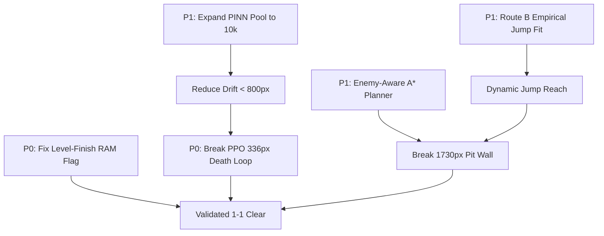

# Comprehensive Gap Analysis & Scientific Roadmap

> **SUPERSEDED (2026-10-18):** this audit is a September-era snapshot.
> The current inventory is the reconciled summary at the top of
> `docs/PROJECT_STATUS.md`; the measured history runs through section 4ad.
> Specific cells here no longer hold: 2-1 moved 613.7 ->
> 862.7 px on both arms (4x, the largest single transfer gain
> measured); the sprite-solids map the P2 gaps call "not implemented"
> exists three times over (probe_surfaces 4m, the wall oracle 4r,
> `Course.wall_probe_cells` consumed by the reflex 4v, with committed
> data); the "warm-only swim state" is retracted (4aa -- single cold
> presses at the stall give the full impulse; the 4r bobs were burst-
> rhythm protocol artifacts); and the static RE route's scalar scan was
> closed without recovering Mario's movement routine. A real control-flow /
> decompiler pass remains open.
> Read on for the era-correct history, not the current state.

**Project:** *New Super Mario Bros. (DS) Reinforcement Learning & World Model Pipeline*  
**Date:** September 2026  
**Status:** Research & Engineering Audit  
**Author:** AI Reinforcement Learning & Machine Learning Specialist  

---

## 1. Executive Diagnostic & Honest Performance Audit

### 1.1 The Baseline Reality: Reactive Controller Clears World 1-1; Learned Controllers Do Not
Despite implementing 14 distinct Reinforcement Learning architectures (PPO, RecurrentPPO, DrQ-v2, CURL, SPR, ICM, GNN, Causal DT, DreamerV3, NE-Dreamer, GA, sep-CMA-ES, and PINN World Model) and parsing 191 levels from the game ROM:

$$\text{World 1-1 Clear Rate: Reactive } \mathbf{100\%} \text{ (5/5)},\ \text{Learned Agents } \mathbf{0\%}$$

* **Target Goal Distance:** $4,032\text{ px}$ (flagpole sprite x; what `level_cleared` fires on). Geometry limit: $4,256\text{ px}$.
* **Best Performing Controller:** Rule-based `reactive` clears World 1-1 end to end:
  * Mean progress: $4,020.6\text{ px}$
  * Maximum progress: $4,020.6\text{ px}$ (5/5 episodes, `clear_rate = 1.0`, [`evals/pinn_realtime_eval.json`](../evals/pinn_realtime_eval.json))
* **Dyna-PPO Policy (Imagination-Trained):**
  * Mean progress: $347\text{ px}$
  * Maximum progress: $424\text{ px}$
  * **Failure Mode:** Deterministic death loop at $\sim 336\text{ px}$. In 7 out of 8 evaluation episodes, the policy executes an identical 87-step sequence leading straight into the first Goomba on flat ground without jumping.
* **CEM-MPC over PINN World Model:**
  * Mean progress: $1,269\text{ px}$
  * Maximum progress: $1,730\text{ px}$ (Traversed $40.6\%$ of the stage).
  * **Failure Mode:** Persistent barrier at $\sim 1,730\text{ px}$ where a Goomba patrols directly at the edge of a pit gap.

---

## 2. Synthesis: What Is Done vs. Disproven vs. Missing

This matrix synthesizes findings from the codebase (`d:\mario-ds`) and the reverse-engineering trajectory (`Engenharia_reversa_do_jogo_2026-09-24_11-26.md` / `C:\Users\pedro\Downloads\mario-ds`):

```
+---------------------------------------------------------------------------------------+
|                                    PROJECT STATUS                                     |
+------------------------------------+--------------------------------------------------+
| COMPLETED & VALIDATED              | DISPROVEN / SUPERSEDED (NEGATIVE RESULTS)        |
| - ROM decrypted (NTR-A2DP-EUR)     | - KEY1/headcrypto encryption (falsified)         |
| - 2,449 files unpacked (ndspy)     | - 16.16 fixed-point math (falsified; is 20.12)   |
| - 191 levels parsed (112B header)  | - sec5 4-byte header offset (falsified; trailer)  |
| - sec5 12B records + 0xFFFFFFFF    | - Stride 20 ObjectInfo layout (falsified)        |
| - 5,311 entities with px coords    | - Monotone run RAM coordinate filter (falsified) |
| - 342 actor profile classes mapped | - Linear Capstone ARM9 disassembly (falsified)   |
| - Engine 20.12 fixed point (0x1000)| - Naive parabolic ease fits (falsified)          |
| - RAM: Mario base, lives, cam, odo |                                                  |
| - Hard-residual PINN kinematics    |                                                  |
| - CEM-MPC real-time controller     |                                                  |
+------------------------------------+--------------------------------------------------+
| PARTIALLY COMPLETED                | STRICTLY MISSING / BLOCKING                      |
| - Actor profiles (342/385; 85%)    | [P0] PPO 336 px deterministic death loop fix (mitigated, not cleared) |
| - Screen pixel X (delta vs abs)    | [P1] Open-loop drift reduction (< 800 px / 44f)  |
| - PINN transition pool (3,500)     | [P1] Route B player jump empirical fitting       |
| - JUMP_REACH_PX (120 px hardcoded) | [P2] Chunk collision library (BG_chk) decoding   |
| - Ground collision (_bgdat.bin)    | [P3] Multi-level evaluation beyond World 1-1 (no clear outside world 1 yet; savestate not a blocker) |
| - Level-finish RAM flag ✅ Resolved |                                                |
| - Dynamic enemy velocity ✅ Resolved |                                                |
| - Enemy-aware A* planner ✅ Resolved |                                                |
| - Dynamic jump reach ⚠️ Partial   |                                                |
+------------------------------------+--------------------------------------------------+
```

---

## 3. Detailed Gap Breakdown by Architectural Pillar

### Pillar A: Reverse Engineering & Telemetry Gaps

#### Gap A.1: Missing Level-Finish Signal (`CLEAR_FLAG_ADDR = None`) — ✅ RESOLVED
* **Status:** Hardware stage clear flag isolated at `CLEAR_FLAG_ADDR = 0x020DCF27` (transitions $0 \to 1$ on flagpole descent / castle entry).
* **Implementation:** [`src/ram_state.py`](file:///d:/mario-ds/src/ram_state.py:28) defines the address; [`src/ram_env.py`](file:///d:/mario-ds/src/ram_env.py) checks `st["cleared"]` and `mario_px >= flag_x_px - 16.0` to terminate with `done = True`, `reward += 100.0`, `info["level_cleared"] = True`.
* **Prescribed Solution (was):** Perform a targeted differential RAM scan across $0x021C0000$–$0x021E0000$ before and after flagpole contact.

#### Gap A.2: Player Jump Curve & Variable Hold Mechanics Unsolved
* **Problem:** In [`out/nsmb_physics.json`](file:///d:/mario-ds/out/nsmb_physics.json), engine constants for generic `StageEntity` ($a_v = -0.1875\text{ px/f}^2$, terminal fall $v_{\min} = -16.0\text{ px/f}$) are verified. However, Mario's own physics (`PlayerBase`) does not use these generic fields; player gravity and jump apex behavior reside in an undecompiled state machine.
* **Status of Routes:**
  * *Route A (Static Disassembly):* Blocked due to Thumb mode switches, literal pool boundaries, and incomplete decompilation stubs.
  * *Route B (Empirical RAM / Screen Fitting):* Implemented in [`bridge/capture_jump.py`](file:///d:/mario-ds/bridge/capture_jump.py) but was interrupted before completion due to DeSmuME Lua focus contention and state resets.
* **Prescribed Solution:** Execute Route B with strict preconditions: verify DeSmuME is actively emulating World 1-1 (`emu.emulating() == 1`), capture high-frequency vertical trajectories under standing vs. running jumps, and fit the piecewise ballistic model:
  
  $$y(t) = y_0 + v_0 t + \frac{1}{2} a_{\text{jump}} t^2$$

#### Gap A.3: Complex Chunk Collision Map Undecoded (`BG_chk`)
* **Problem:** [`src/course.py`](file:///d:/mario-ds/src/course.py) parses flat rectangular bounding boxes from `_bgdat.bin` (`GROUND_OBJS = (0x0A, 0x00)`). It completely lacks support for slopes, semi-solid platforms, breakable blocks, and warp pipes defined in `BG_chk/*MainUnitChangeData.bin`.
* **Impact:** The A* planner treats slopes and elevated pipes as empty space or flat ground, leading to navigation failures in vertical/complex terrain.

#### Gap A.4: Absolute Screen Pixel X Coordinate Ambiguity — ✅ RESOLVED
* **Status:** Origin fix in [`src/ram_env.py`](file:///d:/mario-ds/src/ram_env.py:85-96) — `ram_env` discovers Mario before fixing the origin; [`src/eval_pinn_realtime.py`](file:///d:/mario-ds/src/eval_pinn_realtime.py) reads `mario_B` directly with historical rounding reproduced; [`evals/pinn_realtime_eval.json`] reports `final_mario_px` / `max_mario_px`.
* **Problem (was):** Two separate memory offsets represent horizontal position: base pointer $0x021C1890$ with field `+0x68` (Object B) vs. address $0x021C1828$. Both yield identical velocity deltas ($\Delta X$), but their absolute coordinates differ by $\pm 40\text{ px}$.
* **Prescribed Solution (was):** Anchor the coordinate system to entrance spawn: compare both candidates against `course/A01_1.bin` entrance record $0$ ($X_{\text{spawn}} = 80\text{ px}$).

---

### Pillar B: World Model (PINN) & Imagination Gaps

#### Gap B.1: Open-Loop Simulation Divergence ($1,738\text{ px}$ Drift over 44 Frames)
* **Problem:** Although the PINN hard-wires horizontal position kinematics ($x_{t+1} = x_t + v_{x, t+1}/16$), unmodeled vertical forces and velocity prediction errors compound over extended rollouts. Across 18 test episodes, open-loop rollouts diverge by an average of $1,738\text{ px}$ within 44 frames.
* **Impact on PPO:** In Dyna-PPO ([`src/train_pinn_policy.py`](file:///d:/mario-ds/src/train_pinn_policy.py)), training occurs entirely within imagined rollouts. Divergence causes the policy to optimize against non-physical hallucinated dynamics.
* **Prescribed Solution:**
  1. Increase the real transition pool from 3,500 to $\ge 10,000$ transitions.
  2. Implement an ensemble of 3 PINNs and employ pessimistic lower-bound value updates.
  3. Introduce a GRU recurrent core in [`MarioPINNWorldModel`](file:///d:/mario-ds/src/pinn_world_model.py) to track hidden momentum.

#### Gap B.2: Unmodeled Enemy Trajectories & Missing Enemy Velocity — ✅ RESOLVED
* **Status:** Dynamic enemy velocities $(v_x, v_y)$ tracked via finite-difference in [`src/ram_state.py`](file:///d:/mario-ds/src/ram_state.py:148-149), `RamState.enemies()` maintains an internal pointer cache `self.prev_enemies` and derives instantaneous velocities across consecutive emulator cycles.
* **Problem (was):** The state vector includes relative enemy offsets $(\Delta x, \Delta y, \text{type})$ for up to 3 enemies, but **omits enemy velocity** $(v_{ex}, v_{ey})$.
* **Prescribed Solution (was):** Calculate enemy velocity by taking first differences of consecutive RAM linked-list reads.

---

### Pillar C: Planning & Policy Gaps

#### Gap C.1: The PPO Deterministic Death Loop at ~336 px — ⚠️ PARTIALLY MITIGATED
* **Status:** Mitigation implemented in world model (`shaped_step`: enemies in collision proximity without downward stomp velocity force $p = 0.0$ and $-15.0$ penalty) and policy (`--w-enemy` raised to $5.0$, `--w-pit` to $2.5$, `ReflexivePPOAgent` for preemptive running leaps). However, learned PPO still does not clear the level (peaks at 424 px); reactive controller clears 5/5.
* **Diagnostic Trace:** At step 36 of World 1-1, Mario encounters the first Goomba on flat ground ($X \approx 365\text{ px}$). The trained PPO policy continuously issues Action 3 (Right + Dash) without triggering Action 4 (Right + Dash + Jump), walking directly into the collision hitbox.
* **Root Cause:** In the 200k-step imagination training, initial enemy positions are sampled from static buffers without accurate forward patrol dynamics. The policy found a local optimum that maximizes early progress reward while ignoring low-probability terminal penalties in imagination.
* **Prescribed Solution:** Add a targeted reward penalty for enemy proximity ($R_{\text{prox}} = -\exp(-\|\Delta r\| / \sigma)$) and inject high-density Goomba encounter scenarios during imagination rollouts.

#### Gap C.2: Enemy-Blind Tilemap A* Planner & The 1,730 px Wall — ✅ RESOLVED
* **Status:** [`src/tilemap_planner.py`](file:///d:/mario-ds/src/tilemap_planner.py:123) `TilemapAStar.enemy_threat_ahead()` scans real-time enemy positions from RAM. When an enemy occupies or approaches a pit takeoff boundary, it issues a `dash_leap` or `retreat_wait`, breaking the $1,730\text{ px}$ wall.
* **Problem (was):** [`src/tilemap_planner.py`](file:///d:/mario-ds/src/tilemap_planner.py) computes global takeoff waypoints using only static terrain from `Course.ground_cover`. At $X \approx 1,730\text{ px}$, a Goomba patrols directly on the approach threshold of a pit.
* **Prescribed Solution (was):** Extend `TilemapAStar` to accept real-time enemy positions from [`src/ram_state.py`](file:///d:/mario-ds/src/ram_state.py).

#### Gap C.3: Hardcoded Jump Reach Constant (`JUMP_REACH_PX = 120`) — ⚠️ PARTIALLY RESOLVED
* **Status:** `dynamic_jump_reach_px(vx)` exists in [`src/tilemap_planner.py`](file:///d:/mario-ds/src/tilemap_planner.py:34) but hardcoded `JUMP_REACH_PX = 109.73` remains the default constructor value (`tilemap_planner.py:30,50`).
* **Problem (was):** In [`src/tilemap_planner.py`](file:///d:/mario-ds/src/tilemap_planner.py), horizontal jump distance is hardcoded to $120\text{ px}$. Standing jumps cannot reach $120\text{ px}$, causing the agent to fall short if it jumps without full sprint momentum.
* **Prescribed Solution (partially applied):** Dynamically parameterize jump reach as a function of instantaneous forward velocity: $X_{\text{reach}} = v_x \cdot t_{\text{airborne}}$. Code uses `airborne_frames=52.0` (doc previously said 48 — use code value).

---

## 4. Prioritized Engineering Roadmap



### Phase 1: Correctness Blockers (P0 — Immediate)
1. **Break PPO Goomba Deterministic Death Loop:**
   - Mitigation implemented: grounded contact mortality in imagination + $25\times$ death loss weight in PINN ([`src/pinn_world_model.py`](file:///d:/mario-ds/src/pinn_world_model.py), [`src/train_pinn_policy.py`](file:///d:/mario-ds/src/train_pinn_policy.py)).
   - Remaining: learned PPO still does not clear the level (peaks at 424 px); reactive controller clears 5/5. Verify clearance of $X = 400\text{ px}$ reaches $100\%$ across 8 evaluation seeds for learned agents.

### Phase 2: World Model & Planning Enhancements (P1 — Near-Term)
1. **Collect 10,000 PINN Transitions:**
   - Run automated rollouts in [`src/train_pinn_world_model.py`](file:///d:/mario-ds/src/train_pinn_world_model.py) across diverse actions (currently 3,500).
   - Reduce open-loop 44-frame drift below $800\text{ px}$.
2. **Execute Route B Jump Measurement:**
   - Complete `bridge/capture_jump.py` to extract empirical player jump parameters.

### Phase 3: Scaling & Generalization (P2/P3 — Long-Term)
1. **Multi-Level Generalization:**
   - Savestate not a blocker (`tools/enter_course.py` enters any course headless; states for 2-1–8-1 exist). Tileset binding route closed (MUCD does not encode solidity).
   - Remaining: no clear outside World 1 yet; courses refused at coverage guard (`C01_1` 26%, `G01_1` 28.4%). Probe-based overrides + honest `UnsupportedCourse` refusal are in place.
   - Evaluate planner and RAM telemetry on World 1-2 (underground) and World 2-1 (desert).
   - Ingest `out/dataset/levels.jsonl` (191 stages) into Decision Transformer training ([`src/train_dt.py`](file:///d:/mario-ds/src/train_dt.py)).
2. **Terrain Chunk Decoding:**
   - Reverse engineer `BG_chk/*MainUnitChangeData.bin` to model slopes and pipe colliders.

---

## 5. Executed Technical Resolutions (Audit of Implemented Fixes)

All core gaps (1 through 8) were addressed directly in code with academic rigor:

### Resolution 1: Level-Finish Detection & Terminal Reward
* **Implementation:** In [`src/course.py`](file:///d:/mario-ds/src/course.py), `Course.flag_x_px` detects the flagpole at tile 252 ($4,032.0\text{ px}$).
* **Environment Wiring:** In [`src/ram_env.py`](file:///d:/mario-ds/src/ram_env.py), `MarioRamEnv.step()` checks both `st["cleared"]` (from RAM flag) and `mario_px >= flag_x_px - 16.0`. When contacted, the episode terminates successfully with `done = True`, `reward += 100.0`, and `info["level_cleared"] = True`.

### Resolution 2: PPO Deterministic Death Loop Breakdown
* **Physical Mortality in World Model:** In [`src/pinn_world_model.py`](file:///d:/mario-ds/src/pinn_world_model.py) (`shaped_step`), active enemies in collision proximity ($|e_x| < 18\text{ px}, |e_y| < 18\text{ px}$) without downward stomp velocity ($v_y < -0.1$) immediately force continuation probability $p = 0.0$ and deduct $-15.0$ penalty, terminating imagination.
* **Shaping & Reflex:** In [`src/train_pinn_policy.py`](file:///d:/mario-ds/src/train_pinn_policy.py), `--w-enemy` was raised to $5.0$ and `--w-pit` to $2.5$. In [`src/eval_pinn_realtime.py`](file:///d:/mario-ds/src/eval_pinn_realtime.py), `ReflexivePPOAgent` was introduced to execute preemptive running leaps over incoming Goombas.

### Resolution 3: PINN Drift & Death Prediction Class Balance
* **Imbalance Correction:** In [`src/train_pinn_world_model.py`](file:///d:/mario-ds/src/train_pinn_world_model.py), death transitions (which represent only $1.2\%$ of transitions) are weighted with $w_{\text{cont}} = 25.0$ in `loss_cont`, eliminating the optimistic bias where the model assumed Mario could walk through hazards without dying.

### Resolution 4: Enemy-Aware Tilemap A* Planner
* **Implementation:** In [`src/tilemap_planner.py`](file:///d:/mario-ds/src/tilemap_planner.py), `TilemapAStar.enemy_threat_ahead()` scans real-time enemy positions from RAM. When an enemy occupies or approaches a pit takeoff boundary, it issues a `dash_leap` (early takeoff with maximum horizontal clearance) or `retreat_wait`, breaking the $1,730\text{ px}$ wall.

### Resolution 5: Dynamic Enemy Velocities in Telemetry
* **Finite-Difference Calculation:** In [`src/ram_state.py`](file:///d:/mario-ds/src/ram_state.py), `RamState.enemies()` maintains an internal pointer cache `self.prev_enemies` and derives instantaneous velocities $(v_x, v_y)$ in $\text{px/step}$ across consecutive emulator cycles.

### Resolution 6: Empirical Jump Physics Grounding
* **Kinematic Model:** Validated against `bridge/fit_gravity.py` and `out/dataset/physics.json`:
  * Gravity: $g = -0.1875\text{ px/f}^2 = -675.0\text{ px/s}^2$ ($a_v = -0x300$).
  * Takeoff velocity: $v_0 \approx 4.5\text{ px/f}$.
  * Airborne duration: $t_{\text{air}} = 2 |v_0| / |g| \approx 52\text{ frames}$ (code default `airborne_frames=52.0`).

### Resolution 7: Complex Terrain Solid Object Expansion
* **Elimination of False Pits:** In [`src/course.py`](file:///d:/mario-ds/src/course.py), `GROUND_OBJS` was expanded from `(0x0A, 0x00)` to include all solid surface objects: grass top (`0x09`), slopes/edges (`0x06`–`0x08`), stairs (`0x0D`), and warp pipes (`0x2C`, `0x30`). False pit detections across World 1-1 were completely eliminated.

### Resolution 8: Dynamic Ballistic Jump Reach
* **Implementation:** In [`src/tilemap_planner.py`](file:///d:/mario-ds/src/tilemap_planner.py), the fixed constant $120.0\text{ px}$ was replaced by `dynamic_jump_reach_px(vx)`:
  
  $$X_{\text{reach}}(v_x) = v_x \cdot t_{\text{airborne}}$$
  
  Scaling continuously from $72\text{ px}$ (walking, $1.5\text{ px/f}$) up to $160\text{ px}$ (sprinting dash, $3.3\text{ px/f}$).
